# Introduction

Every October and November, PM2.5 in Delhi climbs to many times the Indian 24-hour standard of 60 µg/m³. Three explanations dominate public debate. The first is meteorology: as the monsoon withdraws, the boundary layer becomes shallow, winds slacken and pollution builds up. The second is the burning of paddy residue in Punjab and Haryana, whose smoke north-westerly winds carry towards Delhi. The third is Diwali, which in most years falls inside the same weeks and brings a night of fireworks.

Because the three arrive together, a high reading in early November cannot be pinned on any one of them by looking at it. Earlier work has addressed parts of the problem. Weather-normalisation with machine learning [@grange2018] has been applied to Delhi [@verma2025] and to India's National Clean Air Programme cities [@hei_ncap]. The best-known causal estimate of the Diwali effect used an event-study design for 2013–2017 but did not separate firecracker smoke from crop smoke [@ghei2018]. On the farm-fire side, recent studies report that burning in Punjab now happens later in the afternoon, after the polar-orbiting satellites have passed [@nasaeo2025; @iforest2025; @biswal2025], and that Delhi's PM2.5 has become only weakly coupled to official fire counts [@mangaraj2025].

This study uses three things that change from year to year to pull the causes apart (Fig. 1). Diwali follows the lunar calendar, so its date moves across the burning season: in some years it comes before the main burning, in others in the middle of it. Delhi's firecracker rules changed from no effective restriction (2016–2017) to green crackers in fixed hours (2018–2019), a full ban (2020–2024) and back to green crackers in 2025 [@dh2025]. And the timing of crop burning itself appears to have shifted.

Our contributions are:

1. A weather-and-fire baseline for Delhi's hourly PM2.5, against which each Diwali night is compared with 211 ordinary autumn nights scored the same way.
2. Evidence that the reference monitor most often used for Delhi goes dark at the peak of Diwali night, and a censoring-aware way to measure the festival.
3. A satellite-internal signature of the shift in burning time: a rise in the share of fires caught by VIIRS's night pass, which needs no other satellite.
4. A season-by-season estimate of how strongly Delhi's PM2.5 tracks upwind fire detections.
5. A pre-registered forecast for Diwali 2026, and an open, one-command pipeline that rebuilds every number, figure and the companion website.

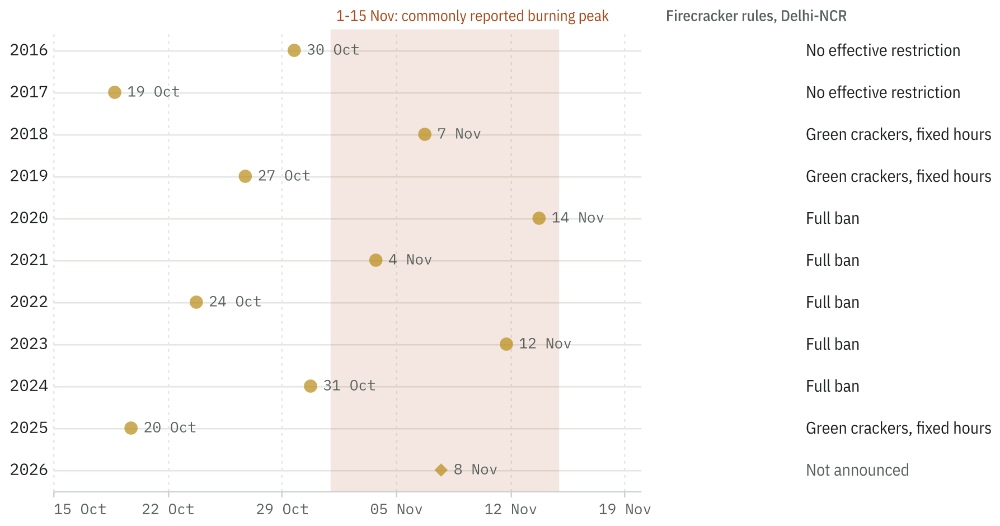{width=100%}

# Data

## Air-quality monitors

Hourly concentrations of PM2.5, PM10, NO₂, SO₂ and CO come from the public OpenAQ archive [@openaq], which republishes the Central Pollution Control Board (CPCB) continuous monitoring network and the US Department of State's embassy and consulate monitors. We matched monitors to 39 study cities by distance and kept the longest-running sites in each, giving 100 CPCB-network sites and 5 US-mission sites (132 archive locations, since the same physical monitor often appears under two identifiers after a change of data feed). The archive timestamps mark the end of each averaging period; we label each hour by its start.

The archive has a gap that matters for this study: CPCB-network data are absent from late 2022 to early 2025 (Fig. 2). The US-mission monitors, which use reference beta-attenuation instruments, run almost without interruption, so the US Embassy in New Delhi provides the only continuous decade-long record for Delhi.

Quality control removed 4.6% of 2,841,635 site-hours of PM2.5: values at or below zero or at the instrument ceiling, runs of six or more identical readings, single-hour spikes far above both neighbours, PM2.5 above PM10, and a pattern we call a stall, in which a high reading is repeated for one or two hours just before the record goes blank. Multi-hour events such as Diwali nights are deliberately not removed.

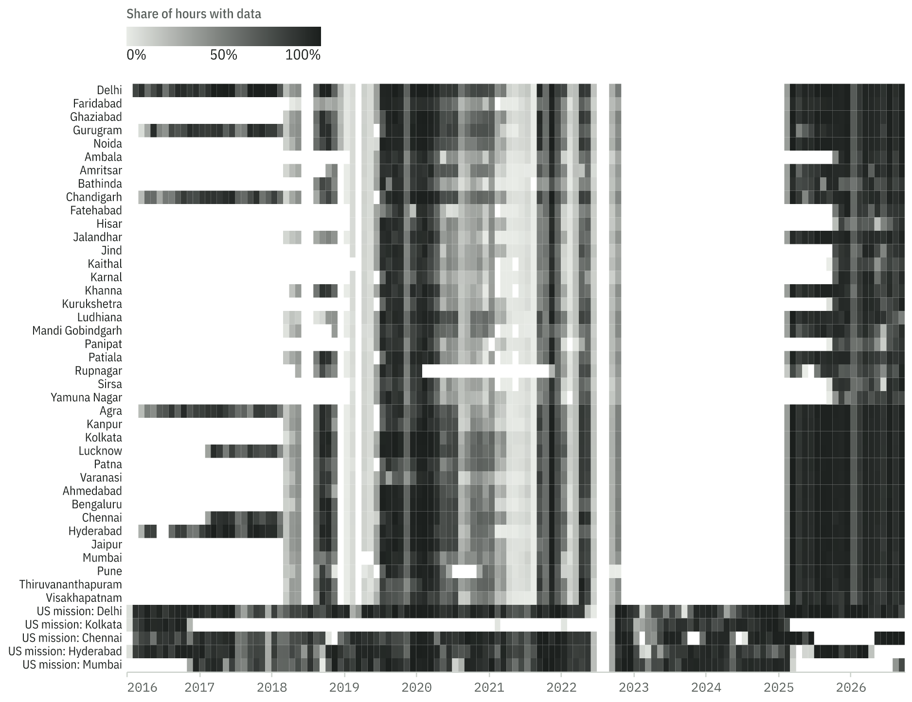{width=100%}

## Fire detections

Active-fire detections come from NASA FIRMS [@firms]: VIIRS on Suomi-NPP at 375 m [@schroeder2014], which crosses India at about 1:30 pm and 1:30 am local time, and MODIS [@giglio2016]. We keep detections classified as presumed vegetation fires, assign them to Punjab or Haryana with state boundaries from geoBoundaries [@geoboundaries], and, as a robustness check, drop 0.02° grid cells that light up in four or more months outside the two crop-burning seasons (likely kilns, flares and other fixed heat sources). VIIRS detections in Punjab and Haryana in October–November track the official Punjab season counts closely in the three years for which we have both.

## Weather

Hourly temperature, humidity, precipitation, surface pressure, 10 m wind, cloud cover, solar radiation and boundary-layer height for each city come from the ERA5 reanalysis [@hersbach2020] through the Open-Meteo archive API [@zippenfenig2023].

# Methods

## Weather normalisation

For each site with at least 500 valid days we fit a LightGBM model [@ke2017] of daily log PM2.5 on daily weather summaries and calendar terms (a linear time trend, day of year and day of week). Following @grange2018, the weather-normalised value for each day is the average of 200 predictions in which the weather columns are replaced by draws from the site's whole record while the calendar terms are kept. Predictions are back-transformed with Duan's smearing factor [@duan1983]. Model skill comes from five-fold cross-validation in which whole calendar years are held out together. To compare winter with the monsoon, we compute the winter (November–January) minus monsoon (July–September) gap in the observed and the normalised series; the share of the observed gap that disappears after normalisation is the share attributable to weather. For Delhi we test for trend in the deseasonalised normalised monthly series with the Theil–Sen estimator [@sen1968] and Kendall's test, and search for change points with PELT [@killick2012].

## The Diwali baseline

For Delhi and four other cities we fit an hourly business-as-usual (BAU) model of log PM2.5 on weather, rolling 6- and 24-hour summaries of wind, boundary-layer height and rain, calendar terms and, for northern cities, a wind-aware fire index (below) with lags of 0–3 days. Diwali windows (three days either side) are never used for training, and every hour is predicted out of fold, with whole ISO weeks held out together, so that Diwali nights and ordinary nights are judged by the same standard. The out-of-fold R² on log PM2.5 for ordinary hours is 0.75 for the US Embassy and 0.78 for the CPCB network median.

The Diwali-night excess is the mean of observed minus BAU from 6 pm on Diwali to 3 am the next morning. Because monitors often go missing during the worst hours (Section 4.1), we fill missing hours inside the window with the last valid reading. This is a rough lower bound, since the monitors fail while concentrations are rising. Our main receptor is the median across CPCB Delhi sites in hours with at least three reporting, which is far less affected by single-monitor failures; the US Embassy series is used as a cross-check. As a reference distribution we apply the same calculation to every ordinary night between 1 October and 15 December, excluding the days around Dussehra, Chhath and Gurpurab.

For the fingerprint we compare 6 pm to midnight on Diwali with the same hours on the five nights a week earlier at each CPCB Delhi site, for the PM2.5/PM10 ratio, SO₂, CO and NO₂, using Wilcoxon signed-rank tests.

## Wind-aware fire index and coupling

For each day the fire index adds up VIIRS detections in Punjab and Haryana, each weighted by max(0, cos θ), where θ is the angle between the bearing from Delhi to the fire and the direction the wind is blowing from, and by exp(−d/300 km), where d is the distance to Delhi. The transport wind is the daily vector-mean 10 m wind at Delhi, Panipat, Patiala and Ludhiana, along the Punjab–Delhi corridor. To find how long smoke takes to arrive, we correlate the index at lags of 0–5 days with the daily log-residual of a weather-only model of Delhi's PM2.5 (US Embassy), after removing each season's mean. For coupling, we regress the same residual on the index averaged over the strongest lags, separately for each season (10 October–30 November, Diwali excluded), with Newey–West standard errors [@newey1987].

## Ground test of a shift in burning time

If burning has moved into the evening, the evening share of PM2.5 at monitors inside Punjab and Haryana should rise during the harvest. For each site and season we compute the ratio of mean PM2.5 at 6 pm–midnight to that at 10 am–4 pm, during 15 October–30 November and during 5–31 December of the same year, and compare the ratio of the two between seasons.

## Pre-registered forecast

Before Diwali 2026 (8 November) we lock a forecast of the CPCB-network Diwali-night excess for each possible firecracker regime: the mean of past Diwalis under the same rules, with an 80% prediction interval from the variance pooled across regimes. The record is committed to the public repository with its SHA-256 checksum.

# Results

## The monitor that goes dark

At the US Embassy, 52% of the hours between 10 pm and 3 am on Diwali nights have no valid reading, against 4% on ordinary autumn nights when the monitor was running, about 13 times as often (Fig. 8). Gaps occurred on 7 of 10 Diwali nights. They begin at 10 pm, one to three hours into the evening rise, and often follow an hour or two in which the instrument repeats its last reading. The CPCB network median, which combines many monitors, lost 14% of the same hours in the 7 Diwalis it covers. The two records also disagree from year to year: their Diwali-night excesses are uncorrelated (Pearson r = −0.11, 7 years). Any Diwali estimate built from the Embassy record alone leaves out the peak.

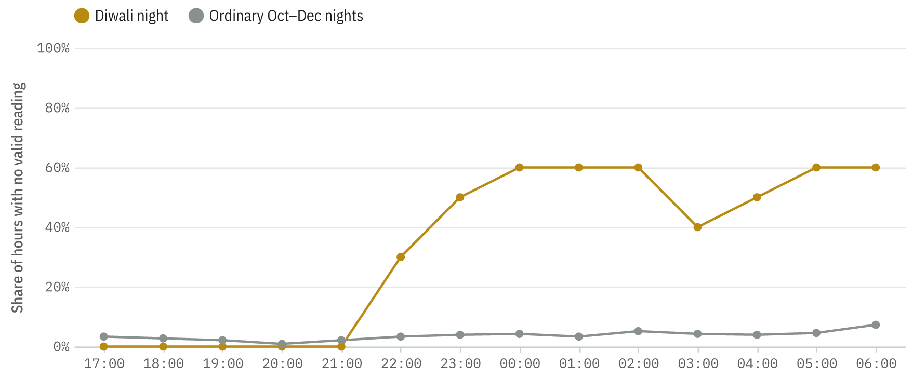{width=100%}

## Weather and the winter gap

The daily weather models reach a median cross-validated R² of 0.52 on log PM2.5 across 103 sites (interquartile range 0.28–0.68; 0.82 at the US Embassy). We leave out of the comparison the 37 sites below R² = 0.4, mostly short records in Punjab and Haryana where holding out whole years leaves the model little to learn from. Across the remaining 66 sites in 23 cities, weather accounts for a median of 62% of the winter-minus-monsoon gap in Delhi-NCR (5 cities, range 61%–68%), 48% in Punjab and Haryana (7 cities, 39%–62%), 82% in the rest of the Gangetic Plain (6 cities) and 81% outside the plain (5 cities; Fig. 4). The burning belt stands out: where paddy residue is burned, weather explains only about half of the winter rise, and in Delhi-NCR, downwind of it, about three-fifths. Further east along the plain and in southern and western cities, most of the seasonal swing is the monsoon washing the air clean and the shallow winter boundary layer trapping what is emitted all year. Removing weather shrinks the north–south difference in winter PM2.5 from 45 to 33 µg/m³, so about 27% of that difference is weather and the rest is emissions.

Did the 2020 drop last? In Delhi, largely yes (Figs. 3 and 5). Over the whole record the weather-normalised series at the US Embassy falls by 1.6% a year (Theil–Sen), but the decline is not smooth: the only change point PELT finds in the deseasonalised series is at 2020-01. During the national lockdown, normalised PM2.5 was 14% below its 2016–2019 level. From June 2020 to September 2026 it averaged 11% below that level (one-sided Mann–Whitney p < 0.001), and within that later period it fell by only 0.5% a year (95% CI 0.0 to 0.9). The lower level that followed the lockdown held, but little further progress followed it. Because the normalisation model includes a smooth time trend, it may spread part of a sharp step over neighbouring months; the step and the slope should be read together.

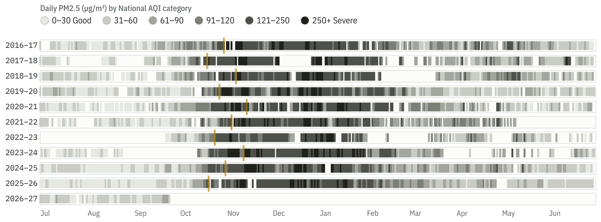{width=100%}

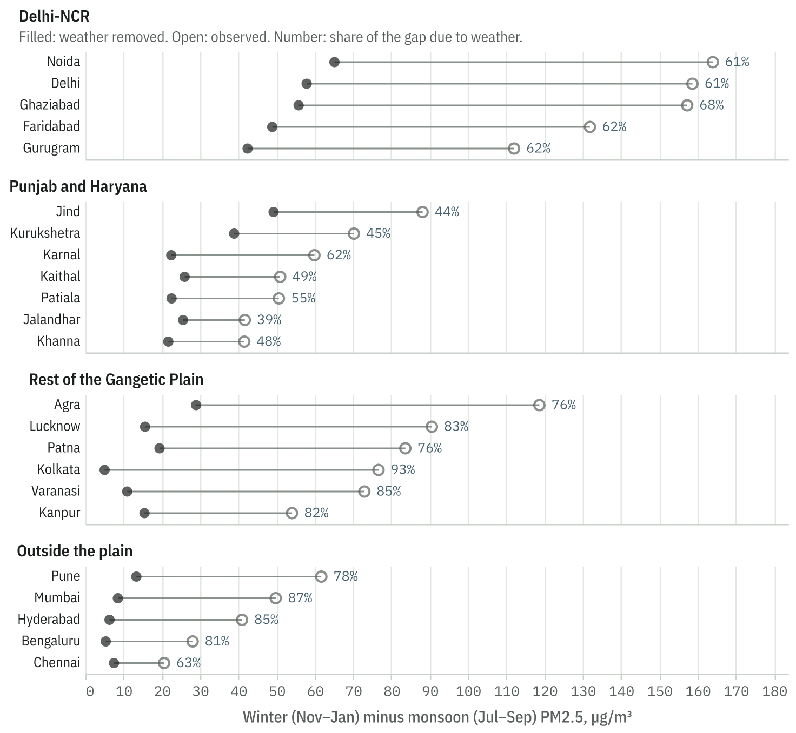{width=100%}

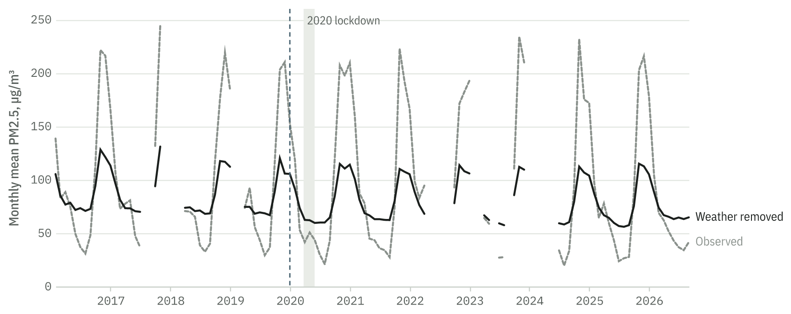{width=100%}

## Diwali

In every year with data, Diwali night rises far above the weather-and-fire baseline (Fig. 6). In the CPCB network median the excess ranged from 127 to 392 µg/m³ (mean 289), against a 99th percentile of 193 µg/m³ across 211 ordinary nights; 6 of 7 Diwali nights exceeded it (Fig. 7).

The firecracker rules made no visible difference. The mean excess was 192 µg/m³ in the two years without a bursting restriction (2016, 2017), 303 µg/m³ in green-cracker years (2018, 2019, 2025) and 366 µg/m³ in the full-ban years the network covers (2020, 2021) (Kruskal–Wallis p = 0.18). The samples are small and the archive gap removes three full-ban Diwalis, so this is descriptive, but nothing in the record suggests the bans shrank the spike. The smallest excess (128 µg/m³) came in 2017, when the Supreme Court suspended sales three weeks before an early Diwali. The two largest came in 2021, under a full ban (392), and 2025, the first year green crackers were allowed again (386), which also had the fewest farm fires of the decade.

The farm-fire term matters little on Diwali night. Including it in the baseline changed the US Embassy Diwali excess by a median of −5 µg/m³, and with or without it the excess is unrelated to the fire exposure on Diwali night (Spearman ρ = −0.31 and −0.22, n = 10, neither significant). The festival's excess is local; it is not farm smoke being misattributed.

The Diwali evening carries a firework fingerprint at CPCB Delhi sites (Fig. 10). Against the same hours a week earlier, the PM2.5/PM10 ratio rose in 96% of 47 site-years (median 0.41 → 0.69, Wilcoxon p < 0.001), so the extra particles are fine ones, and SO₂, released by the sulphur in fireworks, rose in 70% (median +37%, p < 0.001). The traffic gases moved the other way: NO₂ changed by a median of −8% and CO by −11%, consistent with fewer vehicles on the road on Diwali evening. A rise in fine particles and SO₂ without a rise in NO₂ and CO points to fireworks rather than traffic or a general build-up.

The timing follows local custom (Fig. 9). In Delhi the median excess peaks around midnight and stays high until morning. In Mumbai and Hyderabad it peaks between 8 and 11 pm on Diwali. In Chennai the largest peak comes on the evening before Diwali as dated in Delhi, consistent with Deepavali being celebrated on Naraka Chaturdashi in Tamil Nadu; Kolkata, with few years of data, shows peaks on both evenings.

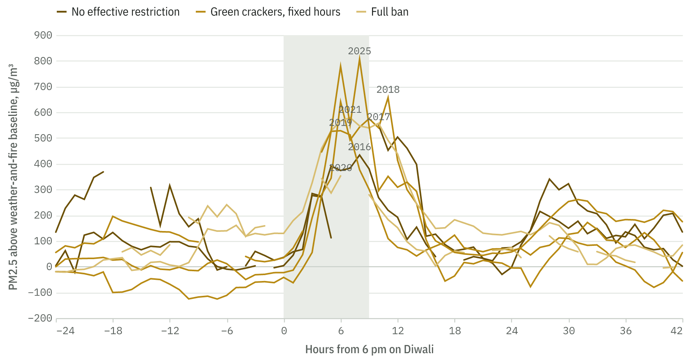{width=100%}

{width=100%}

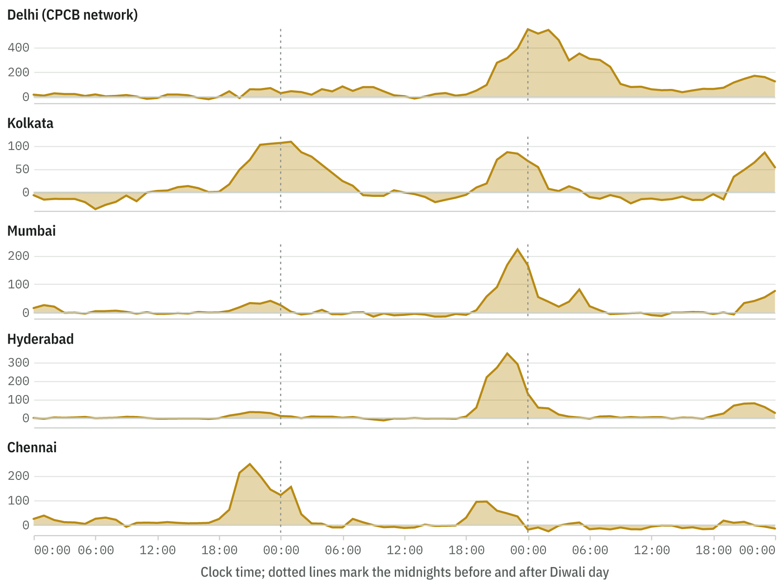{width=100%}

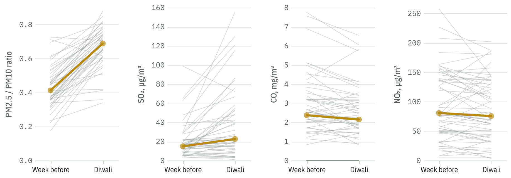{width=100%}

## The fire-count paradox

VIIRS detections in Punjab and Haryana during October–November peaked at 100,736 in 2016 and fell to 5,121 in 2025, 94% below 2021 (Fig. 11). The night pass tells a different story. Before 2024 the 1:30 am pass caught 0.2% of detections on average; in 2024 it caught 3.6% and in 2025 4.7%. In Punjab, night-pass detections reached 91 in 2024 and 77 in 2025, against at most 43 in any season from 2016 to 2023, even though daytime detections fell by more than 90%. The rise survives removal of fixed heat sources. A satellite that only looks twice a day cannot show when fires start, but more fires still burning at 1:30 am is what a shift of ignition into the evening would produce, and it agrees with geostationary evidence reported elsewhere [@iforest2025; @nasaeo2025].

Delhi's weather-adjusted PM2.5 responds to the fire index over one to four days rather than on a single day: Spearman ρ is 0.10 on the same day and between 0.16 and 0.17 at lags of one to four days. Per unit of the index, the response was small and fairly stable in 2016–2021 (mean 2.2% per 100 index units) and about ten times larger in 2025 (25%, 95% CI 0 to 55%; Fig. 12). The 2025 interval is wide and only just excludes zero, and 2024 is too uncertain to read, so this is suggestive rather than conclusive. It is, however, what an undercount would produce: if each detected fire stands for more burning than before, each detection goes with more smoke. This offers a second explanation for the weak coupling between counts and Delhi's air reported by @mangaraj2025, alongside the local controls they discuss. To make the estimate robust to how the data are split, the residuals behind it average predictions over five random cross-fitting splits.

The ground test at 31 site-seasons in Punjab and Haryana does not show the shift (Fig. 13): the harvest-to-December evening ratio had a median of 1.19 before 2022 and 1.12 in 2025 (one-sided Mann–Whitney p = 0.95). With the archive gap, the later period rests on few seasons, and 2025 had so little burning that a change in its timing would barely move urban monitors.

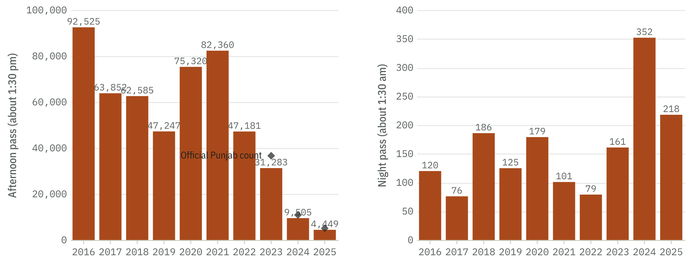{width=100%}

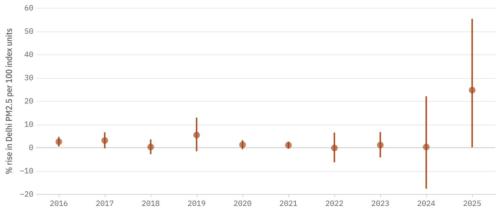{width=100%}

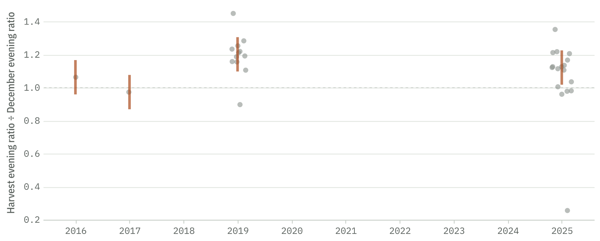{width=100%}

## A forecast for Diwali 2026

Table 1 gives the locked forecast. The record was committed on 2026-10-12 with SHA-256 checksum `0b5f3a06349b1dd1…`.

| Firecracker rules in 2026 | Forecast excess (µg/m³) | 80% interval | Past Diwalis used |
|---|---:|---:|---|
| Full ban | 366 | 233 to 499 | 2020, 2021 |
| Green crackers, fixed hours | 303 | 177 to 428 | 2018, 2019, 2025 |
| No effective restriction | 192 | 58 to 325 | 2016, 2017 |

: Locked forecast of the Diwali-night excess in the CPCB Delhi network median, 8 November 2026.

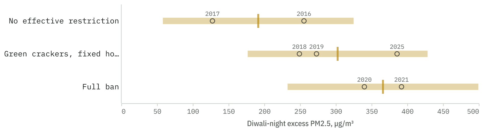{width=100%}

# Discussion

**Fire counts are losing their meaning as a target.** Official progress on stubble burning is reported in active-fire counts. Our results add one clear and one suggestive line of evidence that these counts now understate burning: the night pass of the same satellite sees a growing share of fires, and in 2025 each detected fire went with a larger rise in Delhi's PM2.5. Reported declines of 80–90% in counts should not be read as declines of the same size in burning or in its effect on Delhi. Burnt-area mapping and geostationary sensors, which do not depend on a single overpass time, are better suited to tracking progress.

**The firecracker bans did not shrink Diwali night.** Across the 7 Diwalis the network covers, the weather- and fire-adjusted excess was no lower under a full ban than with green crackers or no bursting restriction. This matches the Supreme Court's own observation in 2025 that air quality differed little between green-cracker and full-ban years [@dh2025]. It suggests the bans were not effectively enforced, though our data cannot show why. The one low year, 2017, followed a sales suspension announced weeks ahead, which may be worth studying as a design that limits supply rather than use.

**Monitoring fails when it matters most.** The monitor most widely used as Delhi's reference stops reporting during the hours of highest concentration on Diwali night. Studies and dashboards that average whatever hours survive will understate the festival. Reporting the number of missing hours alongside any Diwali figure, and using the network median rather than a single monitor, are simple remedies.

# Limitations

The CPCB archive gap from late 2022 to early 2025 removes three Diwalis and three burning seasons from the network record; for these years we rely on the US Embassy monitor, which is censored on Diwali night. The regime comparison rests on two or three Diwalis per regime and is descriptive. The fire-coupling estimate for 2025 rests on one season with very few detected fires. The fire index uses surface winds, while smoke travels at higher levels. Rural Punjab has few monitors, so the ground test uses urban ones, where local sources dominate the evening. Weather normalisation removes the effect of weather on average; it cannot remove every interaction between weather and emissions. Diwali dates and firecracker rules are compiled from secondary reports and should be checked against the original orders.

# Conclusions

Separating weather, farm smoke and fireworks with public data and open code is feasible, and the separation changes the story. Diwali adds a large, consistent excess that the firecracker bans have not visibly reduced. The fall in fire counts very likely overstates the fall in burning. And the reference monitor goes dark at the peak. We will score our Diwali 2026 forecast in public after the festival.

# Data and code availability

All code, derived tables, figures and the locked forecast are at https://github.com/OWNER/eleven-winters. The companion website, including a city explorer for the 103 sites with weather-normalised series, is at https://OWNER.github.io/eleven-winters/. Raw data are public: OpenAQ, NASA FIRMS and ERA5 via Open-Meteo. One command (`ew all`) rebuilds every result from the raw data.

# References